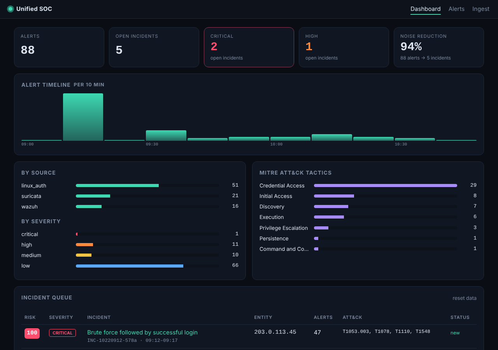
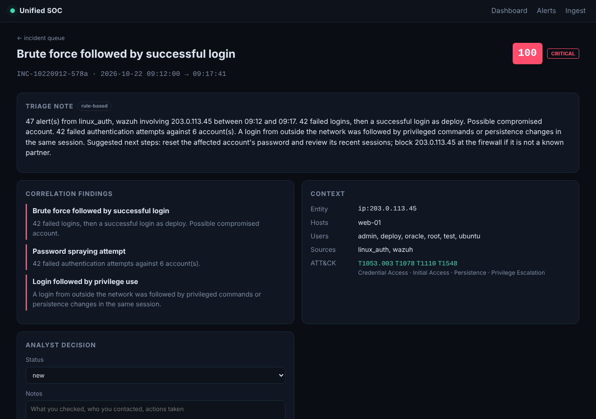

# AI-Powered Unified SOC Dashboard

A lightweight Security Operations Center dashboard that pulls alerts from several security tools into **one normalised view**, scores them, and **correlates them into incidents**, so an analyst works through a short, prioritised queue instead of hundreds of single alerts.

On the bundled sample scenario it turns **88 raw alerts into 5 incidents (94% noise reduction)**, and the top three are the three real attacks hidden in the logs.



## What it does

| Stage | Details |
|---|---|
| **Ingest** | Wazuh `alerts.json`, Suricata `eve.json`, Linux `auth.log` (sshd, sudo), and generic JSON lines. Format is auto-detected; malformed lines are skipped and counted, never fatal. |
| **Normalise** | Every alert becomes one schema: time, source, severity, src/dest IP, host, user, category, MITRE ATT&CK technique and tactic. Tools that don't tag ATT&CK get a keyword-based mapping. |
| **De-duplicate** | Exact duplicates (the same alert forwarded twice) are dropped; repeated *attempts* are kept, because they are evidence. |
| **Score** | 0–100 risk per alert from severity, ATT&CK tactic (later kill-chain stages weigh more), how persistent the source is, critical-host weighting, and internet-facing authentication. |
| **Correlate** | Alerts are grouped by entity (source IP, or user@host) within 30-minute windows. Host-only events like `sudo` are **attributed to the IP that logged in** to that session. |
| **Detect patterns** | Brute force → successful login · Brute force / password spraying · Scan → exploitation attempt · C2 or exfiltration · External login → privilege use or persistence |
| **Triage** | Each incident gets an analyst-style summary with next steps. Optionally a **local LLM** (Ollama) writes a richer triage note on request. |
| **Track** | Analysts set status (new / investigating / closed / false positive) and notes per incident. |

The AI never decides what counts as an incident. Detection and scoring are deterministic rules, so results are explainable and testable; the model only helps the analyst read faster.

## The sample scenario

`sample_data/generate.py` writes synthetic logs for a fictional company. All external addresses come from reserved documentation ranges (`192.0.2.0/24`, `198.51.100.0/24`, `203.0.113.0/24`), so nothing points at real systems.

| What happened | How the dashboard shows it |
|---|---|
| `203.0.113.45` tries 42 passwords on SSH across 6 accounts, gets in as `deploy`, reads `/etc/shadow` and edits crontab | **Critical, risk 100**: *Brute force followed by successful login* + *Password spraying* + *Login followed by privilege use*, 47 alerts from auth.log and Wazuh in one incident |
| HR laptop `10.0.2.15` beacons to `192.0.2.80` every 5 minutes | **Critical, risk 100**: *Possible C2 or exfiltration*, Suricata + Wazuh |
| `198.51.100.23` scans 7 ports, then sends SQL injection and path traversal requests | **High, risk 78**: *Scan followed by exploitation attempt* |
| An employee mistypes their password twice | Not an incident (filtered as noise) |



## Quick start

```bash
git clone https://github.com/shreyash-1406/unified-soc-dashboard.git
cd unified-soc-dashboard
python -m venv .venv && source .venv/bin/activate
pip install -r requirements.txt
python run.py
```

Open http://127.0.0.1:5000 and click **Load sample data**.

Optional AI triage: install [Ollama](https://ollama.com), run `ollama pull llama3.1:8b`, then use **Ask AI for a triage note** on any incident. Without a model, the rule-based summary is used.

Docker:

```bash
docker build -t soc-dashboard .
docker run -p 127.0.0.1:5000:5000 soc-dashboard
```

## Feeding real logs

Upload a file on the **Ingest** page, or stream lines to the API:

```bash
curl --data-binary @/var/log/suricata/eve.json "http://127.0.0.1:5000/api/ingest?format=suricata"
curl --data-binary @/var/log/auth.log           "http://127.0.0.1:5000/api/ingest?format=linux_auth"
curl http://127.0.0.1:5000/api/incidents
```

| Variable | Default | Purpose |
|---|---|---|
| `CRITICAL_HOSTS` | `web-01,db-01,dc-01` | Hosts whose alerts get extra risk weight |
| `SOC_DB` | `soc.db` | SQLite file |
| `USE_AI` | `1` | `0` disables AI triage |
| `LLM_BASE_URL` / `LLM_MODEL` | Ollama / `llama3.1:8b` | Any OpenAI-compatible endpoint |
| `SECRET_KEY` | random | Flask session key |

## Project structure

```
soc/
├── models.py      # common Alert schema, severity/time normalisation
├── parsers.py     # Wazuh, Suricata, auth.log, generic JSON + format detection
├── correlate.py   # dedupe, risk scoring, session attribution, incident grouping, pattern rules
├── store.py       # SQLite: alerts + analyst decisions
├── ai.py          # optional LLM triage notes
├── app.py         # Flask dashboard + JSON API
└── templates/, static/
sample_data/       # deterministic synthetic logs + generator
tests/             # parsing, correlation and web tests
```

## Tests

```bash
pip install -r requirements-dev.txt
pytest -q
```

The tests check that the three planted attacks are found and ranked at the top, that benign activity is not, that incident IDs are stable, that re-ingesting the same file creates no duplicates, and that alert text is HTML-escaped. CI also checks the sample-data generator is deterministic.

## Limitations

- Built for learning and small environments; storage is SQLite and analysis runs in memory
- Correlation rules are hand-written; a production SOC would add threat-intel enrichment and a rules engine such as Sigma
- No authentication yet: keep it bound to `127.0.0.1` or put it behind a reverse proxy with login

## Roadmap

- [ ] Sigma rule support
- [ ] IP reputation enrichment (AbuseIPDB / GreyNoise)
- [ ] Windows Security event parser (4625, 4624, 4672, 4688)
- [ ] Live tail from Wazuh / Elastic APIs
- [ ] User login and audit trail

## Author

**Shreyash Uparkar** · [GitHub](https://github.com/shreyash-1406) · [Portfolio](https://shreyash-1406.github.io)

## License

MIT
